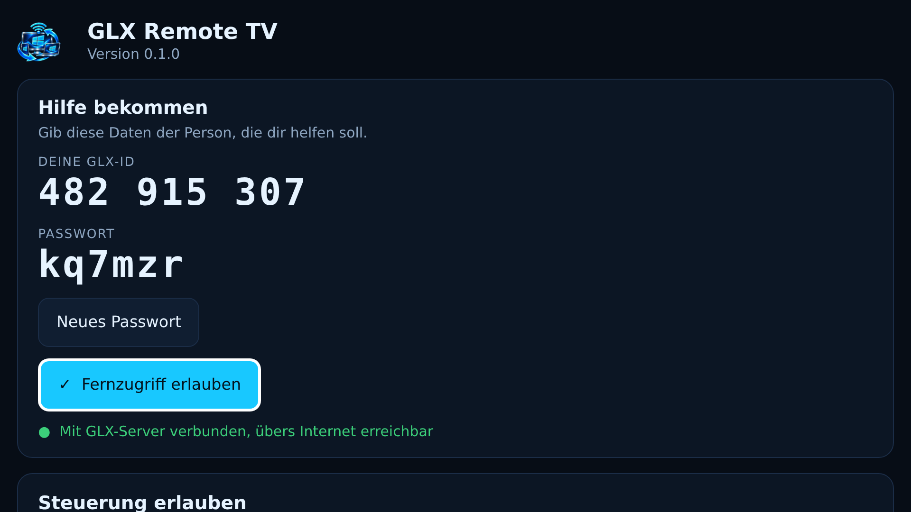
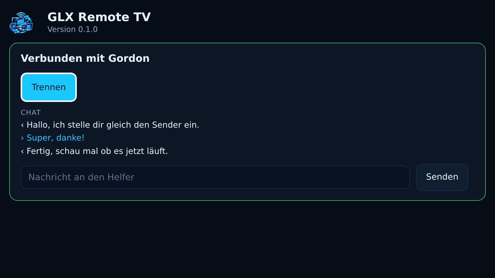
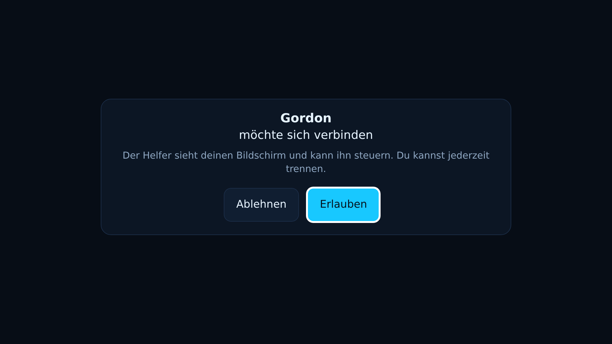

🌍 Sprachen: [🇺🇸 English](README.md) | [🇩🇪 Deutsch](README.de.md)

# 💠 GLX Remote Android

### Fernhilfe für Android-Handys und Tablets.

*Ein Helfer am PC sieht den Bildschirm deines Handys und bedient ihn mit der Maus.* ⚡

   

---

## ⬇️ Download

👉 Neueste Version: [Releases](../../releases/latest)  
👉 Shop und Lizenzen: [glx-tools.de](https://glx-tools.de/product/glx-remote-android-client/)

---

## 📖 Über GLX Remote Android

### Fernhilfe für Android-Handys

GLX Remote Android bringt Fernhilfe auf Android-Handys und -Tablets. Eine Vertrauensperson mit GLX Remote Windows am PC sieht den Bildschirm deines Handys und kann es bedienen, als hielte sie es selbst in der Hand. Ideal für Eltern und Großeltern, die bei einer App oder Einstellung nicht weiterkommen.

### Einfach verbinden

Du liest GLX-ID und Passwort in der App ab, gibst sie weiter und bestätigst die Verbindung am Handy. Das ist alles. Während der Sitzung könnt ihr chatten, und du kannst sie jederzeit beenden.

### Bedienung mit der Maus

Der Helfer tippt per Mausklick, öffnet mit Rechtsklick Kontextmenüs, geht mit der Zurück-Taste der Maus zurück und scrollt mit dem Mausrad. Die App läuft im Hoch- und Querformat und übernimmt das Design vom Programm des Helfers.

### Sicher und privat

Jede Verbindung braucht ID, Passwort und deine Bestätigung. Über das Internet läuft die Verbindung verschlüsselt über den GLX-Server, im selben Netz auch direkt. Die Bildschirmfreigabe nutzt die Android-Bildschirmaufnahme, die Steuerung läuft nur während einer von dir erlaubten Sitzung über die Android-Bedienungshilfen.

### Kostenlos

GLX Remote Android ist kostenlos und ohne Werbung, auf Deutsch und Englisch. Der Helfer nutzt GLX Remote Windows.

---

## 📸 Überblick & Screenshots

### 1️⃣ Startbildschirm mit GLX-ID und Passwort

### 2️⃣ Sitzung mit Chat

### 3️⃣ Verbindungsanfrage

---

## ✨ Funktionen

- 🚀 **Hilfe am Handy aus der Ferne:** Der Helfer sieht deinen Handybildschirm am PC und löst Probleme mit Apps und Einstellungen.
- 🧩 **Maussteuerung:** Tippen per Klick, Rechtsklick für das Kontextmenü, Maus-Zurück-Taste für Zurück, Mausrad zum Blättern.
- ⚙️ **Einfache Verbindung:** GLX-ID und Passwort in der App, am Handy bestätigen, fertig.
- 🔒 **Chat:** Schreibe während der Sitzung mit deinem Helfer.
- 📂 **Jederzeit trennen:** Du behältst die Kontrolle und kannst die Hilfe jederzeit beenden.
- ⚡ **Sicher:** Jede Verbindung braucht ID, Passwort und deine Bestätigung; Internetverbindungen sind verschlüsselt.
- 🎨 **Datenschutz:** Die Steuerung läuft über die Android-Bedienungshilfe nur während einer von dir erlaubten Sitzung.
- 🌍 **Läuft auch auf älteren Geräten:** Ab Android 6 im Hoch- und Querformat; Mausgesten brauchen Android 7 oder neuer.
- 🛠️ **GLX-Design:** Übernimmt die Farben aus dem Design des Helfers, Deutsch und Englisch.
- 📊 **Kostenlos:** Keine Kosten, keine Werbung. Der Helfer nutzt GLX Remote Windows.

---

## 🧩 Systemanforderungen

- Android 6 oder neuer (Mausgesten ab Android 7)
- Der Helfer braucht GLX Remote Windows

---

## 🧪 Testzeitraum & Lizenz

Kostenlos.

---

## 🔗 Mehr zu diesem Produkt

👉 [glx-tools.de](https://glx-tools.de/product/glx-remote-android-client/)  
Support: **info@glx-tools.de**

---

## 📄 Lizenz

Copyright © 2026 GLX Tools – Gordon Lehmann. Alle Rechte vorbehalten.  
Dies ist proprietäre kommerzielle Software. Es wird keine Open-Source-Lizenz gewährt. Dieses Repository enthält nur Release-Downloads und Dokumentation; der Quelltext wird nicht veröffentlicht.

---

Mit ❤️ gemacht von **Dreamdancer100**

