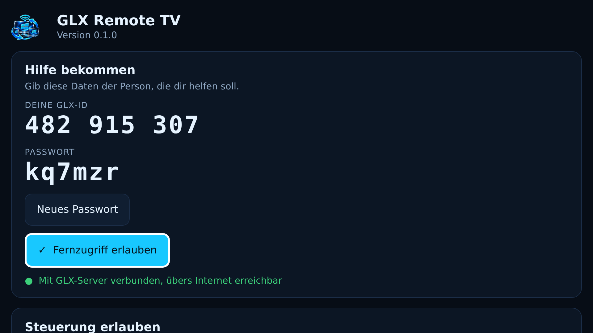
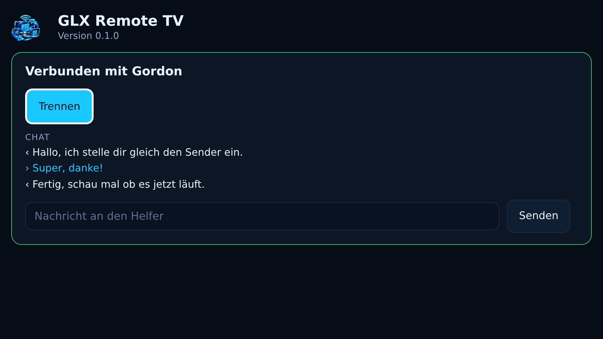
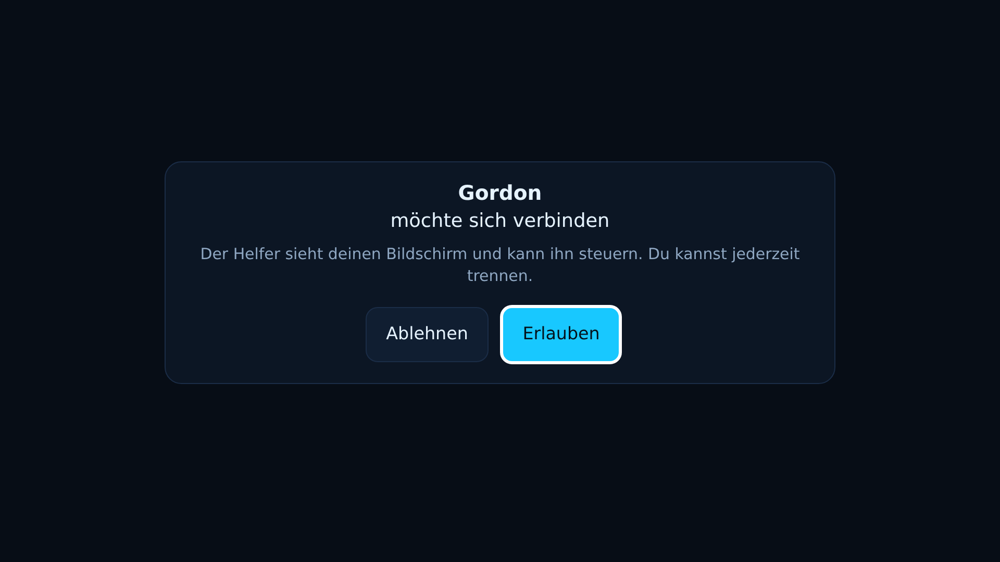

🌍 Languages: [🇺🇸 English](README.md) | [🇩🇪 Deutsch](README.de.md)

# 💠 GLX Remote Android

### Remote help for Android phones.

*A helper on a PC sees your phone screen and operates it with the mouse.* ⚡

   

---

## ⬇️ Download

👉 Latest version: [Releases](../../releases/latest)  
👉 Shop and licences: [glx-tools.de](https://glx-tools.de/product/glx-remote-android-client/)

---

## 📖 About GLX Remote Android

### Remote help for Android phones

GLX Remote Android brings remote help to Android phones and tablets. A trusted person using GLX Remote Windows on a PC sees the screen of your phone and can operate it, just as if they were holding it. Ideal for parents and grandparents who get stuck with an app or a setting.

### Simple to connect

You read your GLX ID and password from the app, pass them on and confirm the connection on the phone. That's all. During the session you can chat with your helper and end it at any time.

### Operated with the mouse

The helper taps with a mouse click, opens context menus with a right-click, goes back with the mouse back button and scrolls with the wheel. The app works in portrait and landscape and takes over the design of the helper's program.

### Secure and private

Every connection needs ID, password and your confirmation. Over the internet the connection is encrypted through the GLX server, in the same network also direct. Screen sharing uses the Android screen capture permission, and control runs through the Android accessibility service only during a session you allowed.

### Free

GLX Remote Android is free of charge and without ads, in German and English. The helper uses GLX Remote Windows.

---

## 📸 Overview & Screenshots

### 1️⃣ Start screen with GLX ID and password

### 2️⃣ Session with chat

### 3️⃣ Connection request

---

## ✨ Features

- 🚀 **Help on the phone from far away:** The helper sees your phone screen on the PC and solves problems with apps and settings.
- 🧩 **Mouse control:** Tap with a click, right-click for the context menu, mouse back button for back, wheel for scrolling.
- ⚙️ **Simple connection:** GLX ID and password in the app, confirm on the phone, done.
- 🔒 **Chat:** Write with your helper during the session.
- 📂 **Disconnect at any time:** You stay in control and can end the help whenever you want.
- ⚡ **Secure:** Every connection needs ID, password and your confirmation; internet connections are encrypted.
- 🎨 **Privacy:** Control runs through the Android accessibility service only during a session you allowed.
- 🌍 **Runs on older devices too:** Works from Android 6 in portrait and landscape; mouse gestures need Android 7 or newer.
- 🛠️ **GLX design:** Takes over the colours of the helper's design, German and English.
- 📊 **Free:** No cost, no ads. The helper uses GLX Remote Windows.

---

## 🧩 Requirements

- Android 6 or newer (mouse control from Android 7)
- The helper needs GLX Remote Windows

---

## 🧪 Trial & License

Free of charge.

---

## 🔗 More about this product

👉 [glx-tools.de](https://glx-tools.de/product/glx-remote-android-client/)  
For support: **info@glx-tools.de**

---

## 📄 License

Copyright © 2026 GLX Tools – Gordon Lehmann. All rights reserved.  
This is proprietary commercial software. No open-source license is granted. This repository contains release downloads and documentation only; the source code is not published.

---

Made with ❤️ by **Dreamdancer100**

